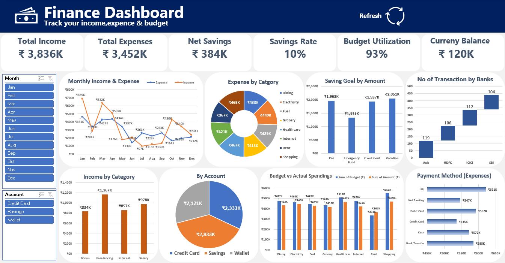

# Finance Analytics Dashboard
An Excel dashboard for exploring personal finance across income, expenses, savings, budgets, accounts, banks, and payment methods.
![Finance dashboard preview]
## Dashboard features
- Summary metrics for income, expenses, net savings, savings rate, budget utilization, and currency balance
- Monthly income and expense trends
- Income and expense breakdowns by category
- Savings goals and transaction counts by bank
- Account balances
- Budget versus actual spending
- Expenses by payment method
- Month and account filters
## Files
- `dashboard/finance_dashboard.xlsx` — Excel dashboard workbook
- `screenshots/finance-dashboard-preview.png` — dashboard preview image
- `data/README.md` — notes about shared data, if applicable
## How to use
1. Download `dashboard/finance_dashboard.xlsx`.
2. Open it in Microsoft Excel.
3. Use the dashboard filters to explore months and accounts.
## Data and privacy
The workbook uses [briefly describe the data source, such as sample or anonymized transaction data]. Review the workbook and remove private or identifying information before sharing it publicly.
## Author
- Rohit Bhagat
## Tools
- Microsoft Excel
